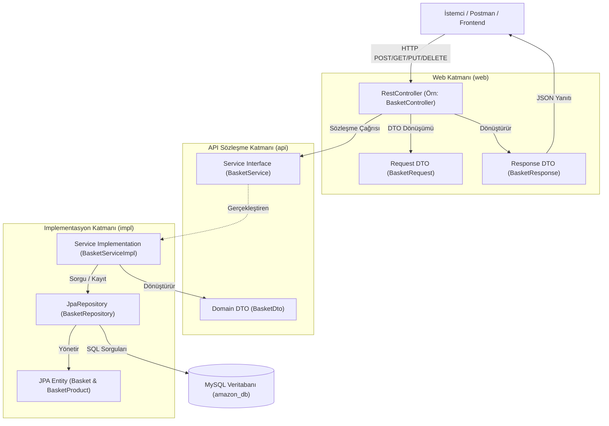
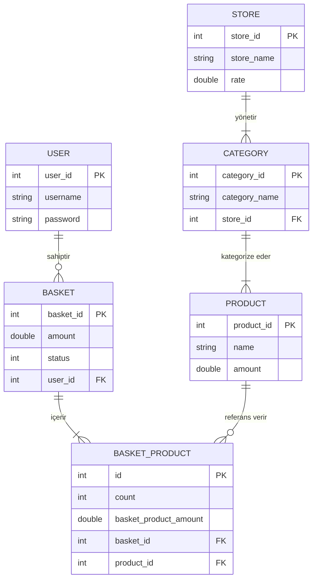

# 🛒 E_comm_amazon

<p align="center">
  <strong>Java 17 ve Spring Boot ile Geliştirilmiş, Domain-Driven Tasarıma Sahip Ölçeklenebilir E-Ticaret REST API Backend Servisi</strong>
</p>

<p align="center">
  <a href="https://github.com/BurhanAlperen/E_comm_amazon">
    
  </a>
  <a href="https://github.com/BurhanAlperen/E_comm_amazon">
    
  </a>
  <a href="https://github.com/BurhanAlperen/E_comm_amazon">
    
  </a>
  <a href="https://github.com/BurhanAlperen/E_comm_amazon">
    
  </a>
  <a href="https://github.com/BurhanAlperen/E_comm_amazon">
    
  </a>
  <a href="https://github.com/BurhanAlperen/E_comm_amazon">
    
  </a>
</p>

<p align="center">
  🌐 <strong>Dil Seçenekleri:</strong> <strong>Türkçe</strong> | <a href="README_EN.md">English</a>
</p>

<p align="center">
  <a href="#-projeye-genel-bakış">Genel Bakış</a> •
  <a href="#-görsel-mimari">Mimari</a> •
  <a href="#-özellikler">Özellikler</a> •
  <a href="#-teknoloji-yığını">Teknolojiler</a> •
  <a href="#-proje-yapısı">Proje Yapısı</a> •
  <a href="#-api-dokümantasyonu">API Dokümantasyonu</a> •
  <a href="#-kurulum-ve-çalıştırma">Kurulum</a> •
  <a href="#-yol-haritası-roadmap">Yol Haritası</a>
</p>

---

## 📖 Projeye Genel Bakış

**E_comm_amazon**, kurumsal standartlarda **Domain-Driven Design (DDD) ve Package-by-Feature** yaklaşımları benimsenerek geliştirilmiş, modüler bir e-ticaret backend servisidir.

Geleneksel monolitik yapılarda kodlar zamanla birbirine sıkı sıkıya bağlanır ve yönetilmesi zorlaşır. **E_comm_amazon**, bu problemi sorumlulukları domain sınırlarına göre (`customer`, `product`, `user`) ayırarak ve her bir domaini üç temel katmanda izole ederek çözer:
1. **`web/`** — HTTP isteklerini, parametre doğrulamalarını ve JSON DTO dönüşümlerini yönetir.
2. **`api/`** — Modüller arası sözleşmeleri temsil eden public servis arayüzlerini ve domain DTO'larını sunar.
3. **`impl/`** — İş kurallarını (Business Logic), JPA varlıklarını (Entity) ve veritabanı erişimini (Repository) kapsüller.

### Temel Yetkinlikler
- **Katmanlar Arası İzolasyon:** Her domain modülü kendi persistence entity'lerini dış dünyadan saklar, veritabanı şemasının doğrudan dışarı sızmasını engeller.
- **Dinamik Sepet Motoru:** Aktif sepet tespiti (`status = 0`), sepetteki mükerrer ürünlerin konsolidasyonu ve toplam tutarın anlık hesaplanması.
- **Katalog ve Hiyerarşik Yapı:** Mağaza - Kategori (`@ManyToOne`) ve Kategori - Ürün (`@OneToMany`) ilişkileriyle kurgulanan çok satıcılı e-ticaret modeli.
- **Kullanıcı Kimlik Doğrulama Döngüsü:** Güvenli kayıt, kimlik kontrolü (`userLogin`) ve şifre gibi hassas bilgilerin yanıtlarda gizlenmesi.

---

## 🏛️ Görsel Mimari

### Katmanlar Arası Veri Akışı



### Çoklu Domain İlişki Şeması (ER Diyagramı)



---

## ✨ Özellikler

### 👤 1. Kullanıcı Yönetimi ve Giriş Doğrulama
- **Kullanıcı Kaydı:** `username` ve `password` bilgileriyle `POST /users` üzerinden yeni hesap oluşturma.
- **Kimlik Doğrulama (`userLogin`):** Kullanıcı adı varlığı ve şifre eşleşmesini kontrol eder; doğruysa `"OK"` döner, hatalıysa `IllegalArgumentException` fırlatır.
- **DTO İzolasyonu:** `UserResponse` sınıfında şifre alanı yer almaz, böylece istemciye hassas veri sızdırılmaz.
- **CRUD Operasyonları:** ID ile kullanıcı sorgulama (`GET /users/{id}`), tüm kullanıcıları listeleme (`GET /users`), bilgi güncelleme (`PUT /users/{id}`) ve hesap silme (`DELETE /users/{id}`).

### 🛒 2. Akıllı Sepet Motoru
- **Duruma Dayalı Sepet Tespiti:** Kullanıcının aktif sepeti `BASKET_STATUS_NONE = 0` statüsüyle sorgulanır veya gerekirse otomatik açılır.
- **Dinamik 3 Senaryolu Sepete Ekleme Akışı:**
  - *1. Senaryo (Aktif Sepet Yok):* Yeni bir `Basket` oluşturulur, kullanıcı bağlanır, ilk `BasketProduct` eklenir ve sepet toplam tutarı hesaplanarak kaydedilir.
  - *2. Senaryo (Sepet Var, Eklenen Ürün Sepette Yok):* `BasketProductService.exist(basketId, productId)` ile ürün yokluğu tespit edilir, sepete yeni ürün satırı eklenir ve toplam tutar güncellenir.
  - *3. Senaryo (Sepet Var, Eklenen Ürün Sepette Zaten Var):* Ürün adedi artırılır (`mevcutAdet + yeniAdet`), ürün tutarı ve sepet genel toplamı yeniden hesaplanır.
- **Sipariş Yaşam Döngüsü Altyapısı:**
  - `0`: NONE (Aktif Sepet)
  - `1`: READY_TO_PAY (Ödeme adımına geçildi)
  - `2`: PAYED (Ödeme alındı)
  - `3`: PROCESSING (Sipariş hazırlanıyor)
  - `4`: DELIVERED (Kargoda / Teslim edildi)
  - `5`: DONE (Süreç tamamlandı)

### 📦 3. Ürün Kataloğu
- **Bağımsız Envanter Yönetimi:** `/products` altında ürün adı ve birim fiyat (`amount`) yönetimi için tam CRUD desteği.
- **MySQL Identity Optimizasyonu:** Otomatik artan ID'ler için `GenerationType.IDENTITY` kullanımı.

### 🏬 4. Mağaza ve Kategori Hiyerarşisi
- **Satıcı/Mağaza Yönetimi:** `/store` altında mağaza puanı (`rate`) ve satıcı profilleri yönetimi.
- **Kategori Taksonomisi:** `/categories` altında mağazalara bağlı (`@ManyToOne`) ve ürünleri gruplayan (`@OneToMany`) kategori yapısı.

---

## 🛠️ Teknoloji Yığını

| Teknoloji | Sürüm / Kapsam | Mimarideki Rolü |
| :--- | :--- | :--- |
| **Java** | `17 (LTS)` | Temel Programlama Dili |
| **Spring Boot** | `4.1.0` | Uygulama Çatısı, Bağımlılık Enjeksiyonu ve Web Sunucusu |
| **Spring WebMVC** | `Spring Boot Starter` | REST API Controller sınıfları, HTTP İstek/Yanıt Yönetimi |
| **Spring Data JPA** | `Spring Boot Starter` | Repository soyutlaması, bildirimsel veritabanı sorguları |
| **Hibernate** | `6.x (JPA Starter)` | Nesne-İlişkisel Eşleme (ORM), şema senkronizasyonu |
| **MySQL** | `8.0+ / Connector-J` | İlişkisel Veritabanı Yönetim Sistemi (RDBMS) |
| **Lombok** | `1.18+` | Getter/Setter/Constructor kod kalabalığını azaltma |
| **Apache Maven** | `3.9+ / Maven Wrapper` | Bağımlılık Yönetimi ve Derleme Otomasyonu |

---

## 📂 Proje Yapısı

```text
src/main/java/com/fotsfer/amazon/
├── AmazonApplication.java                 # Spring Boot Ana Başlangıç Sınıfı
│
└── domain/                                # Domain-Driven Modüller
    ├── customer/                          # Müşteri ve Sepet Alanı
    │   ├── api/                           # Genel Sözleşmeler ve DTO'lar
    │   │   ├── basket/                    # BasketDto, BasketService
    │   │   └── basketProduct/             # BasketProductDto, BasketProductService
    │   ├── impl/                          # İş Mantığı ve Varlıklar
    │   │   └── basket/                    # Basket, BasketProduct, Repository ve Servisler
    │   └── web/                           # REST Controller'lar ve Web Modelleri
    │       ├── basket/                    # BasketController, BasketRequest, BasketResponse
    │       └── basketproduct/             # BasketProductController, Request/Response
    │
    ├── product/                           # Katalog ve Mağaza Alanı
    │   ├── api/
    │   │   ├── category/                  # CategoryDto, CategoryService
    │   │   ├── product/                   # ProductDto, ProductService
    │   │   └── store/                     # StoreDto, StoreService
    │   ├── impl/
    │   │   ├── category/                  # Category Entity, Repository, Servis
    │   │   ├── product/                   # Product Entity, Repository, Servis
    │   │   └── store/                     # Store Entity, Repository, Servis
    │   └── web/
    │       ├── category/                  # CategoryController, Request/Response
    │       ├── product/                   # ProductController, Request/Response
    │       └── store/                     # StoreController, Request/Response
    │
    └── user/                              # Kullanıcı Kimlik Alanı
        ├── api/                           # UserDto, UserService Sözleşmesi
        ├── impl/                          # User Entity, UserRepository, UserServiceImpl
        └── web/                           # UserController, UserRequest, UserResponse
```

---

## 📡 API Dokümantasyonu

Temel URL: `http://localhost:9092`

### 1. Kullanıcı Uç Noktaları (`/users`)

| Metot | URL | Açıklama | İstek Gövdesi (Request) | Yanıt Gövdesi (Response) |
| :--- | :--- | :--- | :--- | :--- |
| `POST` | `/users` | Yeni kullanıcı kaydı | `UserRequest` | `UserResponse` (200 OK) |
| `POST` | `/users/login` | Giriş / Şifre kontrolü | `UserRequest` | `"OK"` (200 OK) veya 500 Hata |
| `GET` | `/users` | Tüm kullanıcıları listele | *Yok* | `List<UserResponse>` |
| `GET` | `/users/{id}` | ID ile kullanıcı getir | *Yok* | `User` Entity |
| `PUT` | `/users/{id}` | Kullanıcı güncelle | `UserRequest` | `UserResponse` |
| `DELETE`| `/users/{id}` | Kullanıcı sil | *Yok* | *200 OK (boş)* |

#### Örnek Kullanıcı İsteği / Yanıtı
```json
// POST /users
{
  "username": "alperen",
  "password": "guvenliSifre123"
}

// Yanıt (200 OK)
{
  "userId": 1,
  "username": "alperen"
}
```

---

### 2. Sepet Uç Noktaları (`/baskets`)

| Metot | URL | Açıklama | İstek Gövdesi (Request) | Yanıt Gövdesi (Response) |
| :--- | :--- | :--- | :--- | :--- |
| `POST` | `/baskets` | Sepete ürün ekle (Yoksa sepet açar) | `BasketRequest` | `BasketResponse` |

#### Örnek Sepet İsteği / Yanıtı
```json
// POST /baskets
{
  "userId": 1,
  "productId": 1,
  "count": 2
}

// Yanıt (200 OK)
{
  "basketId": 1,
  "userId": 1,
  "status": 0,
  "totalPrice": 700.0,
  "products": [
    {
      "basketProductId": 1,
      "count": 2,
      "basketProductAmount": 700.0,
      "basketId": 1,
      "productId": 1
    }
  ]
}
```

---

### 3. Ürün Uç Noktaları (`/products`)

| Metot | URL | Açıklama | İstek Gövdesi (Request) | Yanıt Gövdesi (Response) |
| :--- | :--- | :--- | :--- | :--- |
| `POST` | `/products` | Yeni ürün kaydet | `ProductRequest` | `ProductResponse` |
| `GET` | `/products/{id}` | Ürün detayını getir | *Yok* | `Product` |
| `PUT` | `/products/{id}` | Ürün bilgilerini güncelle | `ProductDto` | `ProductResponse` |
| `DELETE`| `/products/{id}` | Ürünü sil | *Yok* | *200 OK (boş)* |

#### Örnek Ürün İsteği / Yanıtı
```json
// POST /products
{
  "productName": "Kablosuz Kulaklık",
  "productAmount": 350.0
}

// Yanıt (200 OK)
{
  "productId": 1,
  "productName": "Kablosuz Kulaklık",
  "productAmount": 350.0
}
```

---

### 4. Mağaza ve Kategori Uç Noktaları (`/store`, `/categories`)

| Metot | URL | Açıklama | İstek Gövdesi (Request) | Yanıt Gövdesi (Response) |
| :--- | :--- | :--- | :--- | :--- |
| `POST` | `/store` | Yeni mağaza/satıcı oluştur | `StoreRequest` | `StoreResponse` |
| `GET` | `/store/{id}` | Mağaza detayını getir | *Yok* | `StoreResponse` |
| `PUT` | `/store/{id}` | Mağaza bilgilerini güncelle | `StoreRequest` | `StoreResponse` |
| `DELETE`| `/store/{id}` | Mağazayı sil | *Yok* | *200 OK (boş)* |
| `POST` | `/categories` | Yeni kategori oluştur | `CategoryRequest` | `CategoryResponse` |
| `GET` | `/categories/{id}` | Kategori detayını getir | *Yok* | `CategoryResponse` |
| `PUT` | `/categories/{id}` | Kategori güncelle | `CategoryRequest` | `CategoryResponse` |
| `DELETE`| `/categories/{id}` | Kategoriyi sil | *Yok* | *200 OK (boş)* |

---

## 🚀 Kurulum ve Çalıştırma

### Gereksinimler
- **Java Development Kit (JDK):** Sürüm 17 veya üzeri
- **MySQL Veritabanı:** Sürüm 8.0 veya üzeri
- **Derleme Aracı:** Maven (veya proje içindeki Maven Wrapper `./mvnw`)

### 1. Depoyu Klonlayın
```bash
git clone https://github.com/BurhanAlperen/E_comm_amazon.git
cd E_comm_amazon
```

### 2. Veritabanını Yapılandırın
MySQL sunucunuzun çalıştığından emin olun. Şemayı oluşturun (veya `createDatabaseIfNotExist=true` sayesinde otomatik oluşacaktır):
```sql
CREATE DATABASE IF NOT EXISTS amazon_db CHARACTER SET utf8mb4 COLLATE utf8mb4_unicode_ci;
```

`src/main/resources/application.yml` dosyasındaki veritabanı şifrenizi güncelleyin:
```yaml
server:
  port: 9092

spring:
  datasource:
    url: jdbc:mysql://localhost:3306/amazon_db?createDatabaseIfNotExist=true&useSSL=false&serverTimezone=UTC&allowPublicKeyRetrieval=true
    username: ${DB_USERNAME:root}
    password: ${DB_PASSWORD:sifreniz_buraya}
    driver-class-name: com.mysql.cj.jdbc.Driver

  jpa:
    hibernate:
      ddl-auto: update
    show-sql: true
    open-in-view: false
```

### 3. Projeyi Derleyin ve Başlatın

#### macOS / Linux Üzerinde:
```bash
./mvnw clean spring-boot:run
```

#### Windows PowerShell Üzerinde:
```powershell
.\mvnw.cmd clean spring-boot:run
```

#### Yerel Maven ile:
```bash
mvn clean spring-boot:run
```

Uygulama başarıyla başladığında Tomcat **`9092`** portunu dinlemeye başlayacaktır:
```text
Tomcat started on port 9092 (http) with context path '/'
Started AmazonApplication in 2.345 seconds
```

---

## 💻 Örnek İstekler (cURL)

### 1. Kullanıcı Kaydı
```bash
curl -X POST http://localhost:9092/users \
  -H "Content-Type: application/json" \
  -d '{
    "username": "burhan",
    "password": "Sifre123"
  }'
```

### 2. Giriş Yapma (Kimlik Doğrulama)
```bash
curl -X POST http://localhost:9092/users/login \
  -H "Content-Type: application/json" \
  -d '{
    "username": "burhan",
    "password": "Sifre123"
  }'
```

### 3. Ürün Oluşturma
```bash
curl -X POST http://localhost:9092/products \
  -H "Content-Type: application/json" \
  -d '{
    "productName": "Mekanik Klavye",
    "productAmount": 120.0
  }'
```

### 4. Sepete Ürün Ekleme
```bash
curl -X POST http://localhost:9092/baskets \
  -H "Content-Type: application/json" \
  -d '{
    "userId": 1,
    "productId": 1,
    "count": 2
  }'
```

---

## 🗺️ Yol Haritası (Roadmap)

- [x] Domain-Driven katmanlı yapı (`api`, `impl`, `web`)
- [x] İlişkisel varlık modellemeleri (`User`, `Basket`, `BasketProduct`, `Product`, `Category`, `Store`)
- [x] Dinamik sepet tutar hesabı ve ürün adedi konsolidasyonu
- [x] Kimlik ve şifre kontrol mantığı (`userLogin`)
- [ ] **Güvenlik:** JWT (JSON Web Tokens) ile Spring Security entegrasyonu
- [ ] **Şifre Güvenliği:** Veritabanındaki şifreler için `BCryptPasswordEncoder` kullanımı
- [ ] **API Dokümantasyonu:** Swagger / OpenAPI 3.0 arayüzü (`springdoc-openapi`)
- [ ] **Hata Yönetimi:** `@RestControllerAdvice` ile global exception handler ve RFC-7807 hata standartları
- [ ] **Konteynerleştirme:** Dockerfile ve `docker-compose.yml` (Uygulama + MySQL)
- [ ] **Sayfalama ve Sıralama:** Listeleme uç noktalarında `Pageable` desteği
- [ ] **Test Kapsamı:** JUnit 5 ve Mockito ile birim ve entegrasyon testleri

---

## 🔒 Güvenlik Uyarıları

> [!WARNING]
> Bu uygulama eğitim, prototipleme ve mimari gösterim amacıyla geliştirildiğinden şifreleri veritabanında düz metin olarak tutmaktadır. Gerçek canlı ortamlar için:
> 1. Spring Security eklenmeli ve parolalar `BCrypt` ile hashlenmelidir.
> 2. Veritabanı şifreleri kaynak kodda tutulmamalı, ortam değişkenleri (Environment Variables) ile yönetilmelidir.
> 3. CORS politikaları ve HTTPS protokolü zorunlu kılınmalıdır.

---

## 🤝 Katkıda Bulunma

Projeye katkı sağlamaktan memnuniyet duyarız:
1. Depoyu Fork'layın (`https://github.com/BurhanAlperen/E_comm_amazon/fork`)
2. Yeni Özellik Dalı Açın (`git checkout -b feature/YeniOzellik`)
3. Değişiklikleri Commit'leyin (`git commit -m 'feat: Yeni ozellik eklendi'`)
4. Dalı Push'layın (`git push origin feature/YeniOzellik`)
5. Bir Pull Request (PR) Gönderin

---

## 👨‍💻 Geliştirici

**Burhan Alperen**
- GitHub: [@BurhanAlperen](https://github.com/BurhanAlperen)
- Depo Bağlantısı: [E_comm_amazon](https://github.com/BurhanAlperen/E_comm_amazon)

---

## 📄 Lisans

Bu proje şu anda portföy kullanımı için tescillenmiştir. Tüm hakları [Burhan Alperen](https://github.com/BurhanAlperen)'e aittir.