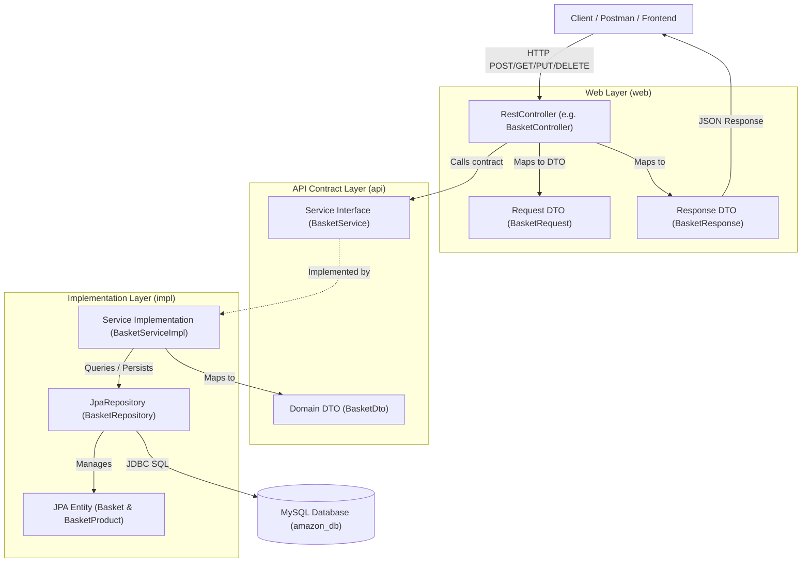
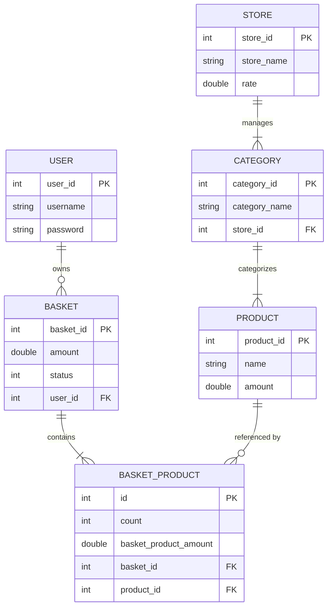

# 🛒 E_comm_amazon

<p align="center">
  <strong>A Scalable, Domain-Driven E-Commerce REST API Backend Powered by Java 17 & Spring Boot</strong>
</p>

<p align="center">
  <a href="https://github.com/BurhanAlperen/E_comm_amazon">
    
  </a>
  <a href="https://github.com/BurhanAlperen/E_comm_amazon">
    
  </a>
  <a href="https://github.com/BurhanAlperen/E_comm_amazon">
    
  </a>
  <a href="https://github.com/BurhanAlperen/E_comm_amazon">
    
  </a>
  <a href="https://github.com/BurhanAlperen/E_comm_amazon">
    
  </a>
  <a href="https://github.com/BurhanAlperen/E_comm_amazon">
    
  </a>
</p>

<p align="center">
  🌐 <strong>Languages:</strong> <a href="README.md">Türkçe</a> | <strong>English</strong>
</p>

<p align="center">
  <a href="#-project-overview">Overview</a> •
  <a href="#-visual-architecture">Architecture</a> •
  <a href="#-features">Features</a> •
  <a href="#-tech-stack">Tech Stack</a> •
  <a href="#-project-structure">Structure</a> •
  <a href="#-api-documentation">API Docs</a> •
  <a href="#-getting-started">Getting Started</a> •
  <a href="#-roadmap">Roadmap</a>
</p>

---

## 📖 Project Overview

**E_comm_amazon** is an enterprise-grade, modular e-commerce backend service architected using **Domain-Driven Design (DDD) & Package-by-Feature** conventions.

In typical monolithic systems, codebases often devolve into tightly coupled, hard-to-maintain files. **E_comm_amazon** addresses this problem by segregating concerns strictly across domain boundaries (`customer`, `product`, `user`) and isolating each domain into three distinct layers:
1. **`web/`** — Handles HTTP transport, validation, and JSON DTO marshaling.
2. **`api/`** — Exposes public interfaces and domain contract DTOs across modules.
3. **`impl/`** — Encapsulates concrete business logic, JPA entities, and repository access.

### Key Capabilities
- **Decoupled Architecture:** Each domain module hides its persistence entities from outer consumers, preventing internal schema leaks.
- **Dynamic Shopping Cart Engine:** Real-time active cart resolution (`status = 0`), cart item consolidation, and automatic cart total recalculations.
- **Product Catalog & Hierarchy:** Store-to-Category (`@ManyToOne`) and Category-to-Product (`@OneToMany`) relational data models.
- **User Authentication Lifecycle:** Registration, credential validation (`userLogin`), and safe user representation without exposing sensitive hashes/passwords.

---

## 🏛️ Visual Architecture

### Domain Layer Isolation Flow



### Multi-Domain Relation Map



---

## ✨ Features

### 👤 1. User Management & Credential Verification
- **User Registration:** Encapsulated onboarding storing `username` and `password` via `POST /users`.
- **Credential Validation (`userLogin`):** Verifies username presence and password equality; returns `"OK"` upon valid match or throws explicit `IllegalArgumentException` on mismatch.
- **Security Isolation:** `UserResponse` strips away the password field, preventing credential exposure to client consumers.
- **CRUD Suite:** Supports user retrieval by ID (`GET /users/{id}`), listing all users (`GET /users`), updating credentials (`PUT /users/{id}`), and account deletion (`DELETE /users/{id}`).

### 🛒 2. Intelligent Cart & Basket Engine
- **State-Aware Cart Identification:** Retrieves or provisions active carts tagged with `BASKET_STATUS_NONE = 0`.
- **Dynamic 3-Case Add-to-Cart Flow:**
  - *Case 1 (No Active Cart):* Instantiates a new `Basket`, attaches the user, creates initial `BasketProduct`, calculates product amount, and sets the initial basket amount.
  - *Case 2 (Cart Exists, New Product):* Identifies product absence via `BasketProductService.exist(basketId, productId)`, appends a new `BasketProduct`, and recalculates total cart price.
  - *Case 3 (Cart Exists, Existing Product):* Consolidates product counts (`existingCount + newCount`), updates line-item amount, and synchronizes the total basket amount.
- **Multi-State Order Lifecycle Ready:** Entity architecture contains lifecycle status definitions:
  - `0`: NONE (Active Cart)
  - `1`: READY_TO_PAY (Checkout initiated)
  - `2`: PAYED (Payment verified)
  - `3`: PROCESSING (Fulfillment)
  - `4`: DELIVERED (Carrier delivery)
  - `5`: DONE (Completed order)

### 📦 3. Product Catalog
- **Independent Inventory Record:** Full CRUD endpoints under `/products` managing item names and decimal prices (`amount`).
- **Entity Identity Optimization:** Employs MySQL `GenerationType.IDENTITY` for optimized database-native primary key auto-incrementation.

### 🏬 4. Store & Category Hierarchy
- **Vendor/Store Management:** Dedicated `/store` endpoints supporting rating metrics (`rate`) and vendor profiles (`storeName`).
- **Category Taxonomy:** Category management under `/categories` linked to parent stores via `@ManyToOne` and product listings via `@OneToMany`.

---

## 🛠️ Tech Stack

| Technology | Version / Scope | Role in Architecture |
| :--- | :--- | :--- |
| **Java** | `17 (LTS)` | Core Programming Language |
| **Spring Boot** | `4.1.0` | Application Framework, Inversion of Control & Web Server |
| **Spring WebMVC** | `Spring Boot Starter` | RESTful API Controllers, HTTP Request/Response Dispatcher |
| **Spring Data JPA** | `Spring Boot Starter` | Repository abstraction, declarative querying |
| **Hibernate** | `6.x (via JPA Starter)` | Object-Relational Mapping (ORM), schema synchronizer |
| **MySQL** | `8.0+ / Connector-J` | Persistent Relational Database Management System |
| **Lombok** | `1.18+` | Boilerplate reduction (`@Getter`, `@Setter`, `@RequiredArgsConstructor`) |
| **Apache Maven** | `3.9+ / Wrapper (mvnw)` | Dependency Management, Lifecycle Build Automation |

---

## 📂 Project Structure

```text
src/main/java/com/fotsfer/amazon/
├── AmazonApplication.java                 # Spring Boot Main Entry Point
│
└── domain/                                # Domain-Driven Modules
    ├── customer/                          # Customer & Cart Domain
    │   ├── api/                           # Public Contracts & DTOs
    │   │   ├── basket/                    # BasketDto, BasketService
    │   │   └── basketProduct/             # BasketProductDto, BasketProductService
    │   ├── impl/                          # Business Logic & Entities
    │   │   └── basket/                    # Basket, BasketProduct, Repositories, ServiceImpls
    │   └── web/                           # REST Controllers & Web DTOs
    │       ├── basket/                    # BasketController, BasketRequest, BasketResponse
    │       └── basketproduct/             # BasketProductController, Request/Response
    │
    ├── product/                           # Catalog & Merchant Domain
    │   ├── api/
    │   │   ├── category/                  # CategoryDto, CategoryService
    │   │   ├── product/                   # ProductDto, ProductService
    │   │   └── store/                     # StoreDto, StoreService
    │   ├── impl/
    │   │   ├── category/                  # Category Entity, CategoryRepository, ServiceImpl
    │   │   ├── product/                   # Product Entity, ProductRepository, ServiceImpl
    │   │   └── store/                     # Store Entity, StoreRepository, ServiceImpl
    │   └── web/
    │       ├── category/                  # CategoryController, Request/Response
    │       ├── product/                   # ProductController, Request/Response
    │       └── store/                     # StoreController, Request/Response
    │
    └── user/                              # User Identity Domain
        ├── api/                           # UserDto, UserService Contract
        ├── impl/                          # User Entity, UserRepository, UserServiceImpl
        └── web/                           # UserController, UserRequest, UserResponse
```

---

## 📡 API Documentation

Base URL: `http://localhost:9092`

### 1. User Endpoints (`/users`)

| Method | Endpoint | Description | Request Body | Response Body |
| :--- | :--- | :--- | :--- | :--- |
| `POST` | `/users` | Create new user account | `UserRequest` | `UserResponse` (200 OK) |
| `POST` | `/users/login` | Verify credentials | `UserRequest` | `"OK"` (200 OK) or 500 Error |
| `GET` | `/users` | List all users | *None* | `List<UserResponse>` |
| `GET` | `/users/{id}` | Get user by ID | *None* | `User` Entity |
| `PUT` | `/users/{id}` | Update username/password | `UserRequest` | `UserResponse` |
| `DELETE`| `/users/{id}` | Delete user account | *None* | *200 OK (void)* |

#### Sample User Request / Response
```json
// POST /users
{
  "username": "alperen",
  "password": "securePassword123"
}

// Response (200 OK)
{
  "userId": 1,
  "username": "alperen"
}
```

---

### 2. Basket Endpoints (`/baskets`)

| Method | Endpoint | Description | Request Body | Response Body |
| :--- | :--- | :--- | :--- | :--- |
| `POST` | `/baskets` | Add product to active basket (Creates if none) | `BasketRequest` | `BasketResponse` |

#### Sample Basket Request / Response
```json
// POST /baskets
{
  "userId": 1,
  "productId": 1,
  "count": 2
}

// Response (200 OK)
{
  "basketId": 1,
  "userId": 1,
  "status": 0,
  "totalPrice": 700.0,
  "products": [
    {
      "basketProductId": 1,
      "count": 2,
      "basketProductAmount": 700.0,
      "basketId": 1,
      "productId": 1
    }
  ]
}
```

---

### 3. Product Endpoints (`/products`)

| Method | Endpoint | Description | Request Body | Response Body |
| :--- | :--- | :--- | :--- | :--- |
| `POST` | `/products` | Create product record | `ProductRequest` | `ProductResponse` |
| `GET` | `/products/{id}` | Get product details | *None* | `Product` |
| `PUT` | `/products/{id}` | Update product details | `ProductDto` | `ProductResponse` |
| `DELETE`| `/products/{id}` | Delete product | *None* | *200 OK (void)* |

#### Sample Product Request / Response
```json
// POST /products
{
  "productName": "Wireless Noise Cancelling Headphones",
  "productAmount": 350.0
}

// Response (200 OK)
{
  "productId": 1,
  "productName": "Wireless Noise Cancelling Headphones",
  "productAmount": 350.0
}
```

---

### 4. Store & Category Endpoints (`/store`, `/categories`)

| Method | Endpoint | Description | Request Body | Response Body |
| :--- | :--- | :--- | :--- | :--- |
| `POST` | `/store` | Register new store/vendor | `StoreRequest` | `StoreResponse` |
| `GET` | `/store/{id}` | Get store by ID | *None* | `StoreResponse` |
| `PUT` | `/store/{id}` | Update store name / rating | `StoreRequest` | `StoreResponse` |
| `DELETE`| `/store/{id}` | Remove store record | *None* | *200 OK (void)* |
| `POST` | `/categories` | Register category | `CategoryRequest` | `CategoryResponse` |
| `GET` | `/categories/{id}` | Retrieve category | *None* | `CategoryResponse` |
| `PUT` | `/categories/{id}` | Update category | `CategoryRequest` | `CategoryResponse` |
| `DELETE`| `/categories/{id}` | Delete category | *None* | *200 OK (void)* |

---

## 🚀 Getting Started

### Prerequisites
- **Java Development Kit (JDK):** Version 17 or higher
- **MySQL Database Server:** Version 8.0 or higher
- **Build Tool:** Maven (or use bundled Maven Wrapper `./mvnw`)

### 1. Clone the Repository
```bash
git clone https://github.com/BurhanAlperen/E_comm_amazon.git
cd E_comm_amazon
```

### 2. Configure Database
Ensure MySQL is running on `localhost:3306`. Create the database schema (optional, as `createDatabaseIfNotExist=true` is enabled in configuration):
```sql
CREATE DATABASE IF NOT EXISTS amazon_db CHARACTER SET utf8mb4 COLLATE utf8mb4_unicode_ci;
```

Update your database credentials in `src/main/resources/application.yml` or supply them via environment variables:
```yaml
server:
  port: 9092

spring:
  datasource:
    url: jdbc:mysql://localhost:3306/amazon_db?createDatabaseIfNotExist=true&useSSL=false&serverTimezone=UTC&allowPublicKeyRetrieval=true
    username: ${DB_USERNAME:root}
    password: ${DB_PASSWORD:your_password_here}
    driver-class-name: com.mysql.cj.jdbc.Driver

  jpa:
    hibernate:
      ddl-auto: update
    show-sql: true
    open-in-view: false
```

### 3. Build & Run Application

#### Using Maven Wrapper (macOS / Linux):
```bash
./mvnw clean spring-boot:run
```

#### Using Maven Wrapper (Windows PowerShell):
```powershell
.\mvnw.cmd clean spring-boot:run
```

#### Standard Maven:
```bash
mvn clean spring-boot:run
```

The application will initialize Tomcat and bind to port **`9092`**:
```text
Tomcat started on port 9092 (http) with context path '/'
Started AmazonApplication in 2.345 seconds
```

---

## 💻 Example Requests

### 1. Register User
```bash
curl -X POST http://localhost:9092/users \
  -H "Content-Type: application/json" \
  -d '{
    "username": "burhan",
    "password": "Password123"
  }'
```

### 2. Verify Credentials (Login)
```bash
curl -X POST http://localhost:9092/users/login \
  -H "Content-Type: application/json" \
  -d '{
    "username": "burhan",
    "password": "Password123"
  }'
```

### 3. Create a Product
```bash
curl -X POST http://localhost:9092/products \
  -H "Content-Type: application/json" \
  -d '{
    "productName": "Mechanical Keyboard",
    "productAmount": 120.0
  }'
```

### 4. Add Product to Basket
```bash
curl -X POST http://localhost:9092/baskets \
  -H "Content-Type: application/json" \
  -d '{
    "userId": 1,
    "productId": 1,
    "count": 2
  }'
```

---

## 🗺️ Roadmap

- [x] Domain-driven layered structure (`api`, `impl`, `web`)
- [x] Entity relationship mapping (`User`, `Basket`, `BasketProduct`, `Product`, `Category`, `Store`)
- [x] Dynamic basket total calculation and line-item consolidation
- [x] Credential verification logic (`userLogin`)
- [ ] **Security:** Spring Security integration with JWT (JSON Web Tokens)
- [ ] **Password Security:** BCrypt password hashing for data-at-rest protection
- [ ] **API Documentation:** Interactive Swagger / OpenAPI 3.0 UI (`springdoc-openapi`)
- [ ] **Error Handling:** Global Exception Handler via `@RestControllerAdvice` & standard RFC-7807 problem details
- [ ] **Containerization:** `Dockerfile` and multi-container `docker-compose.yml` (App + MySQL)
- [ ] **Pagination & Sorting:** Spring Data `Pageable` on all collection endpoints
- [ ] **Automated Testing:** Unit & Integration test coverage with JUnit 5 & Mockito

---

## 🔒 Security Best Practices

> [!WARNING]
> This application currently stores passwords in plaintext for demonstration and architectural prototyping. For production deployment:
> 1. Integrate Spring Security and encrypt all credentials with `BCryptPasswordEncoder`.
> 2. Externalize database passwords using environment variables or a secret vault. Never commit plaintext database credentials to public source control.
> 3. Enforce CORS policies and HTTPS/TLS certificates.

---

## 🤝 Contributing

Contributions, issues, and feature requests are welcome!
1. Fork the Project (`https://github.com/BurhanAlperen/E_comm_amazon/fork`)
2. Create your Feature Branch (`git checkout -b feature/AmazingFeature`)
3. Commit your Changes (`git commit -m 'feat: Add AmazingFeature'`)
4. Push to the Branch (`git push origin feature/AmazingFeature`)
5. Open a Pull Request

---

## 👨‍💻 Author

**Burhan Alperen**
- GitHub: [@BurhanAlperen](https://github.com/BurhanAlperen)
- Project Repository: [E_comm_amazon](https://github.com/BurhanAlperen/E_comm_amazon)

---

## 📄 License

This project is currently unlicensed for proprietary portfolio use. All rights reserved by [Burhan Alperen](https://github.com/BurhanAlperen).
